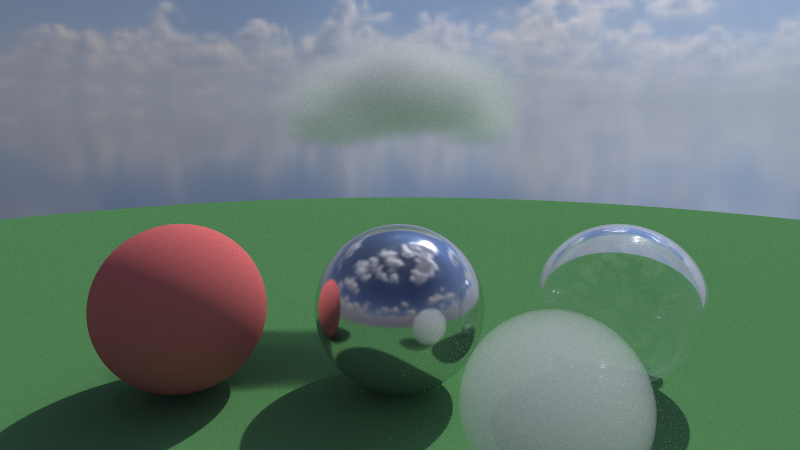

# Mini Path Tracer

Un path tracer Monte Carlo écrit en **C++17** from scratch (CPU, multithread), avec **milieux participants** (brouillard et nuage à densité variable) et **éclairage par image HDR** (IBL). Projet personnel réalisé en parallèle de mon M2 GIG (Aix-Marseille Université) pour comprendre le rendu physique de bout en bout.



*Nuage procédural (grille 3D, delta tracking) éclairé par une HDRI Poly Haven (Kloofendal 48d partly cloudy). 400x225, 300 échantillons par pixel, environ 13 s sur 8 threads.*

## Fonctionnalités

- **Matériaux** : diffus (Lambert), métal (avec rugosité), diélectrique (verre, Fresnel par approximation de Schlick, sphère creuse).
- **Caméra** positionnable (position, cible, champ de vision).
- **Multithreading** (`std::thread`) avec un générateur aléatoire par thread. Gain mesuré d'environ x6 sur 8 threads.
- **Milieux participants**
  - brouillard homogène (loi de Beer-Lambert, diffusion isotrope) ;
  - **nuage à densité variable** : grille 3D 64³, interpolation trilinéaire, rendu par **delta tracking** (Woodcock), nuage procédural par bruit fractal (fBm).
- **IBL** : carte d'environnement équirectangulaire HDR (`.hdr`), lecture bilinéaire, exposition et rotation réglables.
- **Éclairage direct de l'envmap** : échantillonnage d'importance, next-event estimation et multiple importance sampling (voir plus bas).
- **Test de validation** du delta tracking contre l'intégrale numérique de la densité.

## Compilation

Prérequis : un compilateur C++17, CMake >= 3.10.

```bash
git clone https://github.com/issamselmi83/mini-path-tracer.git
cd mini-path-tracer
mkdir build && cd build
cmake ..
make
```

Le build est en `Release` par défaut.

## Utilisation

```bash
./path_tracer [spp] [threads] [envmap.hdr] [intensity] [rotation_deg] [max_radiance]
```

| Argument | Rôle | Défaut |
|---|---|---|
| `spp` | échantillons par pixel | voir `main.cpp` |
| `threads` | nombre de threads (0 = tous les coeurs) | 0 |
| `envmap.hdr` | image HDR équirectangulaire | ciel dégradé |
| `intensity` | exposition de l'envmap | 1.0 |
| `rotation_deg` | rotation de l'envmap autour de l'axe vertical | 0 |
| `max_radiance` | écrêtage par échantillon (anti-fireflies) | 50 |

Exemple avec une HDRI (à télécharger, par exemple sur [Poly Haven](https://polyhaven.com/hdris), en `.hdr` 1K) :

```bash
./path_tracer 300 0 ../data/kloofendal_48d_partly_cloudy_puresky_1k.hdr 0.5
```

L'image est écrite dans `output.ppm`. Les HDRI ne sont pas versionnées.

## Structure du projet

```
src/
  main.cpp         scène, caméra, boucle de rendu multithread, ray_color
  vec3.h           vecteurs 3D
  ray.h            rayon
  sphere.h         intersection rayon/sphère
  hit_record.h     informations d'intersection
  material.h       Lambertien, métal, diélectrique
  volume.h         milieu homogène (brouillard)
  grid_volume.h    milieu à densité variable (grille 3D, delta tracking, bruit fBm)
  envmap.h         envmap HDR : lecture, échantillonnage d'importance
  rng.h            générateur aléatoire par thread
  stb_image.h      chargement HDR (stb_image, domaine public)
tests/
  grid_test.cpp    validation du delta tracking
```

## Comment ça marche

### Path tracing

Pour chaque pixel, on lance des rayons dans la scène. À chaque intersection, le matériau choisit une direction de rebond et la couleur est accumulée le long du chemin. La moyenne sur de nombreux échantillons converge vers la solution de l'équation de rendu.

### Milieux participants

Un rayon traversant un volume ne va pas forcément jusqu'au bout : on tire une distance d'interaction selon une loi exponentielle, ce qui reproduit la transmittance de Beer-Lambert `T = exp(-σ d)`. À l'interaction, le rayon est diffusé de façon isotrope.

Pour une densité variable `σ(p)`, on utilise le **delta tracking** : on avance par pas exponentiels avec une densité majorante `σ_max`, et on accepte la collision avec la probabilité `σ(p) / σ_max`. Le résultat est exact, sans biais. Le test `tests/grid_test.cpp` le vérifie en comparant la probabilité de traversée simulée à `exp(-∫σ)`.

```bash
g++ -O2 -std=c++17 tests/grid_test.cpp -o grid_test && ./grid_test
```

### IBL et éclairage direct (NEE + MIS)

Une HDRI réelle contient un soleil très lumineux mais minuscule. Des rayons tirés au hasard le trouvent très rarement, et l'écrêtage supprimait son énergie : le nuage sortait gris et les ombres floues. Trois éléments corrigent cela :

- **Échantillonnage d'importance** de l'envmap : directions tirées proportionnellement à la luminance de l'image (× sin θ), via des CDF marginale et conditionnelle.
- **Next-event estimation** : à chaque diffusion (volume ou surface diffuse), un rayon d'ombre est lancé vers une direction tirée dans l'envmap. La transmittance à travers les volumes est évaluée de façon stochastique.
- **Multiple importance sampling** (heuristique de puissance) : combine cet échantillonnage avec celui de la BRDF ou de la fonction de phase, sans compter la lumière deux fois.

Les rebonds Lambertiens sont échantillonnés en cosinus.

## Limites et pistes

- Les matériaux spéculaires (métal, verre) ne reçoivent pas d'éclairage direct par NEE.
- Diffusion isotrope uniquement : pas de fonction de phase de Henyey-Greenstein, donc pas d'effet de diffusion vers l'avant des vrais nuages, ni de diffusion multiple anisotrope réaliste.
- Pas d'accélération des volumes : le delta tracking parcourt le rayon pas à pas. Une traversée de grille accélérée (HDDA, grille de majorants par bloc) est la suite logique.
- CPU uniquement. Un portage temps réel (OpenGL/Vulkan, accumulation temporelle, précalcul de l'éclairage) est envisagé.
- Pas de débruitage : la qualité vient du nombre d'échantillons.

## Ce que ce projet démontre

- Maîtrise du **C++ moderne** (C++17, RAII, threads, polymorphisme) et de CMake.
- Compréhension de l'**intégration de Monte Carlo** appliquée au rendu : estimateurs, variance, échantillonnage d'importance, MIS.
- Implémentation et **validation numérique** d'un algorithme de rendu volumétrique (delta tracking).
- Démarche de **mesure et de diagnostic** : profilage du multithreading, identification d'un build non optimisé et d'un verrou sur `rand()`, correction de la perte d'énergie liée à l'écrêtage.

## Références

- Peter Shirley, *Ray Tracing in One Weekend*
- Matt Pharr, Wenzel Jakob, Greg Humphreys, *Physically Based Rendering*
- E. Woodcock et al., *Techniques used in the GE Monte Carlo code for reactor design* (delta tracking)
- [Poly Haven](https://polyhaven.com/) pour les HDRI (CC0)
- [stb_image](https://github.com/nothings/stb) (domaine public)
