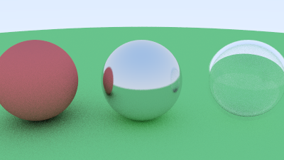
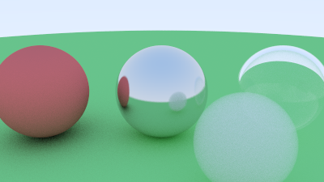
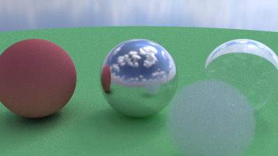

# Mini Path Tracer

Un ray tracer / path tracer écrit from scratch en C++, sans bibliothèque graphique externe. Implémente le rendu physique par Monte Carlo, plusieurs matériaux (diffus, métal, verre), une caméra configurable et un rendu multithreadé.



## Fonctionnalités

- **Rendu par path tracing** : simulation physique de la lumière par Monte Carlo (rebonds aléatoires, moyennés sur plusieurs échantillons par pixel)
- **Matériaux** :
  - Diffus (Lambertian)
  - Métal avec effet de flou réglable (fuzz)
  - Verre (Dielectric) avec réflexion/réfraction selon l'angle (approximation de Schlick)
- **Caméra configurable** : position, cible, champ de vision (field of view)
- **Anti-aliasing** par supersampling
- **Rendu multithreadé** : parallélisation automatique sur tous les cœurs CPU disponibles

## Compilation

Prérequis : CMake 3.10+, compilateur C++17 (g++/clang)

```bash
mkdir build && cd build
cmake ..
make
./path_tracer
```

Génère une image output.ppm dans le dossier build/.

## Structure du projet

```
src/
├── main.cpp        # Boucle de rendu, définition de la scène et de la caméra
├── vec3.h           # Classe vecteur 3D (opérations de base)
├── ray.h            # Représentation d'un rayon (origine + direction)
├── hit_record.h     # Structure décrivant une intersection
├── sphere.h         # Géométrie : intersection rayon/sphère
└── material.h       # Matériaux : Lambertian, Metal, Dielectric
```

## Ce que ce projet démontre

Projet réalisé en autonomie en parallèle de mon M2 GIG (Géométrie Informatique Graphique) à Aix-Marseille Université, pour approfondir les fondamentaux mathématiques du rendu 3D (vecteurs, intersections géométriques, éclairage physique) avant d'attaquer un moteur de rendu temps réel (OpenGL/Vulkan).

Inspiré de la méthode décrite dans [Ray Tracing in One Weekend](https://raytracing.github.io/) de Peter Shirley.

## Milieux participants (brouillard / fumée)



Une sphère de brouillard à densité constante, traversée par les rayons.

- **Loi de Beer-Lambert** : sur une distance d dans le milieu, la fraction de lumière qui traverse sans interagir vaut exp(-densité × d).
- **Implémentation Monte Carlo** : pour chaque rayon, on tire une distance d'interaction -ln(u) / densité. Si elle est plus courte que la distance parcourue dans la sphère, le rayon est diffusé dans une direction uniforme ; sinon il traverse. Cette probabilité de traversée a été vérifiée numériquement (2 millions de rayons : 0,0183 mesuré pour 0,0183 attendu).
- **Réglages** : densité (opacité du milieu) et couleur de diffusion (blanc pour du brouillard, sombre pour de la fumée), dans `volumes.push_back(Volume(...))` de `main.cpp`.

Limites actuelles : densité constante, diffusion isotrope, volumes sphériques uniquement, pas d'échantillonnage direct des lumières (donc du bruit à faible nombre d'échantillons).


## Éclairage par image (IBL)



La scène est éclairée par une carte d'environnement HDR (image équirectangulaire) au lieu d'un simple dégradé de ciel : quand un rayon s'échappe de la scène, il lit sa couleur dans l'image. Le brouillard est éclairé par la même envmap.

- **Chargement** : images `.hdr` (Radiance) via `stb_image`, interpolation bilinéaire, projection équirectangulaire.
- **Utilisation** : `./path_tracer <échantillons> <threads> <envmap.hdr> [intensité] [rotation en degrés] [borne par échantillon]`
- **Envmap de la capture** : Kloofendal 48d Partly Cloudy (Pure Sky), 1K, Poly Haven (licence CC0).

Limites : l'échantillonnage est simple (les rayons ne trouvent le soleil que par hasard), donc un soleil très fort donne du bruit. Chaque échantillon est borné pour éviter les points blancs, ce qui retire une partie de l'énergie du soleil. Piste d'amélioration : échantillonnage d'importance de l'envmap.
